# 蓝白学术风 PPT 技能包

让 AI 助手（Claude、Codex、Hermes 等）直接做出开题、答辩、组会用的 PPT。下面全部是用本技能包实际跑出来的页面，正文 18 pt，所有元素都能在 PowerPoint 里直接编辑。示例内容与数据均为演示用。

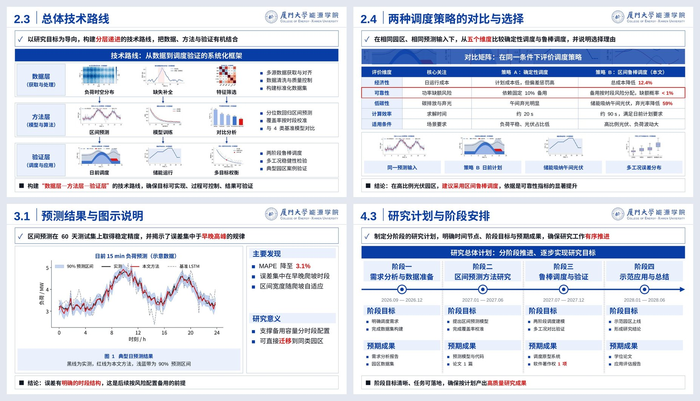

## 开题 / 答辩

| 研究背景 | 研究任务 |
|:---:|:---:|
| 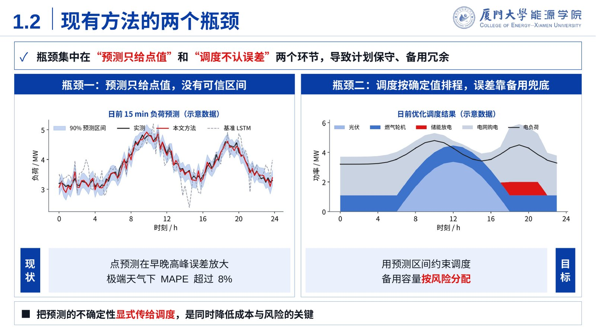 | 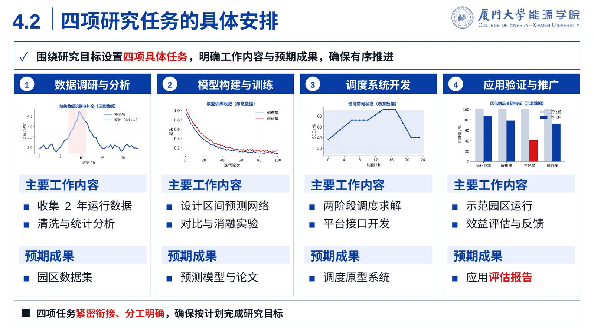 |
| **技术路线** | **方案对比** |
| 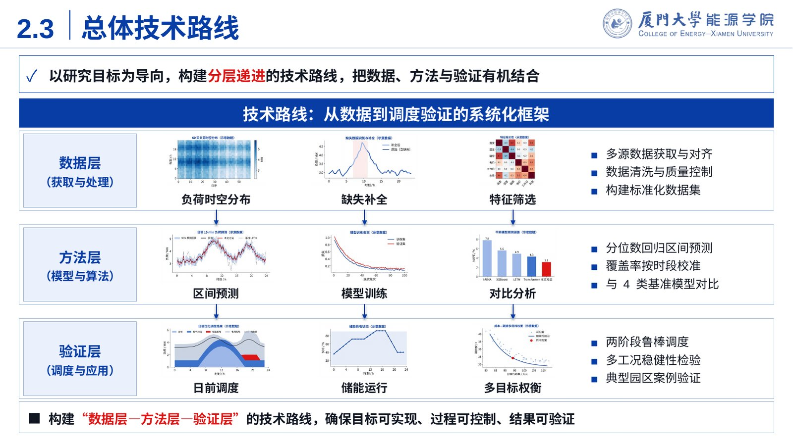 | 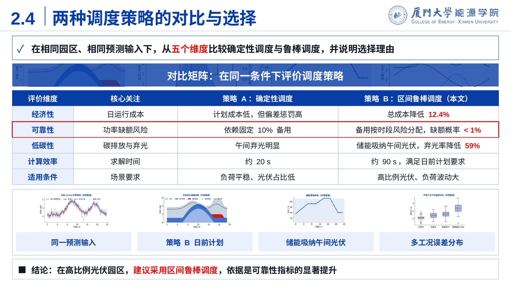 |
| **结果解读** | **研究计划** |
| 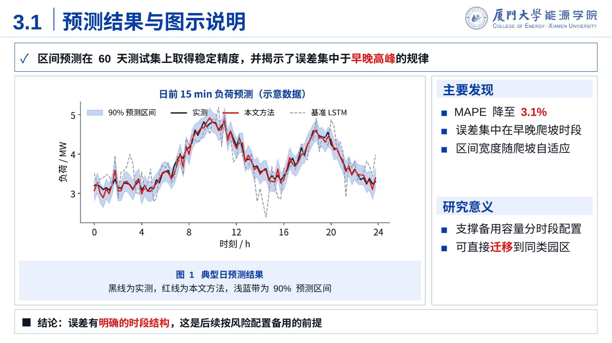 | 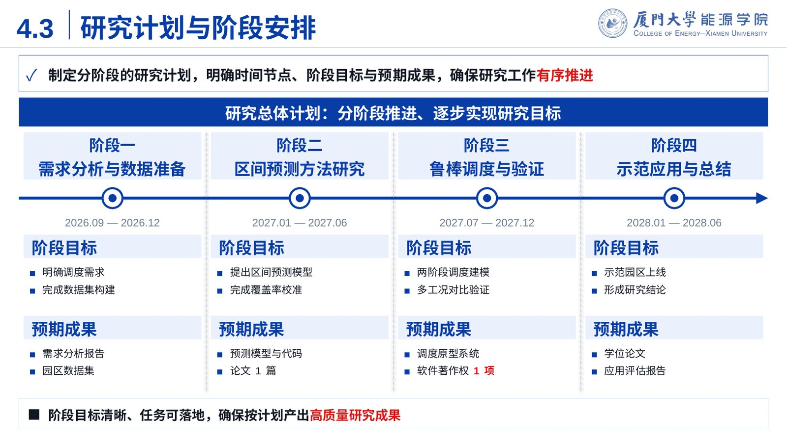 |

28 页全稿：

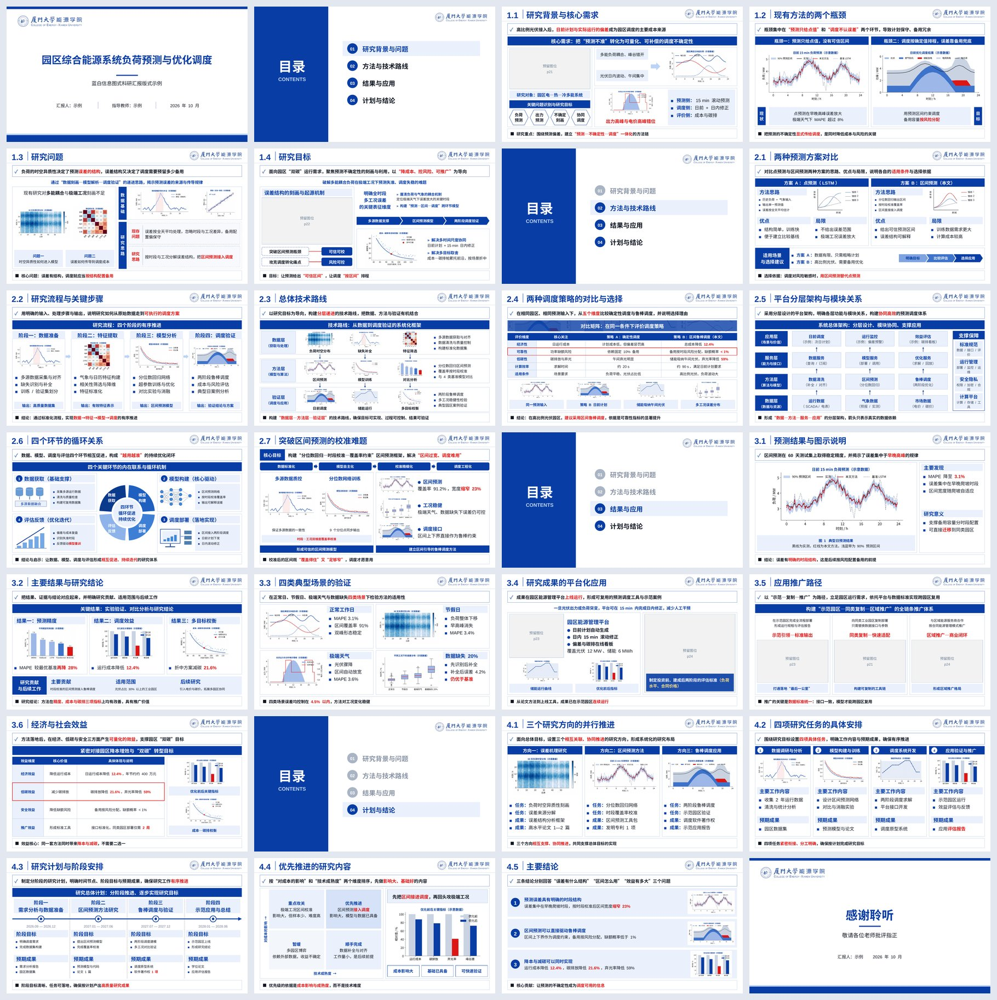

## 组会 / 文献汇报 / 竞选 / 活动策划

| 组会进展 | 文献结论 |
|:---:|:---:|
| 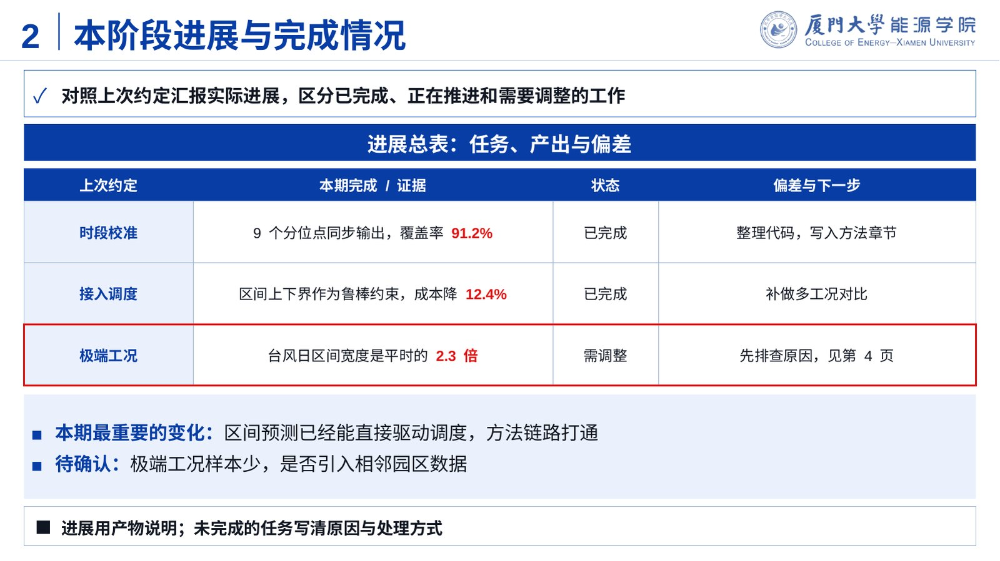 | 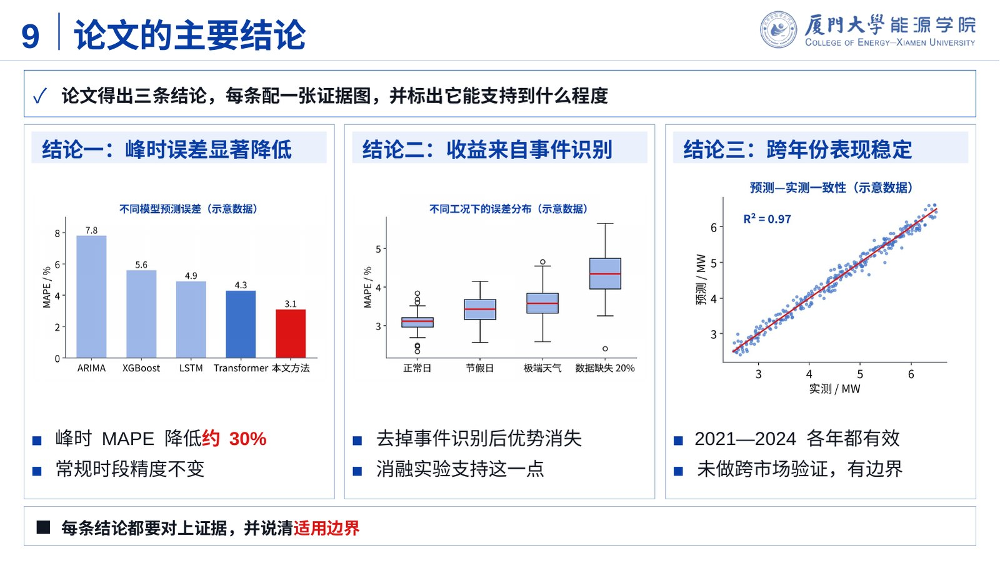 |

19 页全稿：

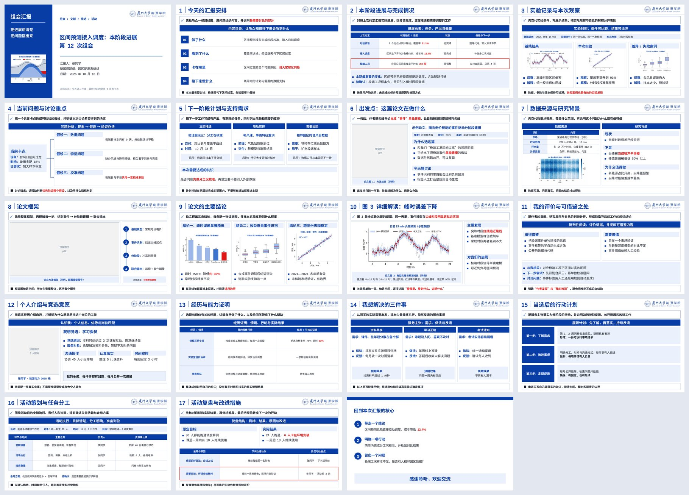

## 大创 / 项目申报答辩

| 正文页 | 结束页 |
|:---:|:---:|
| 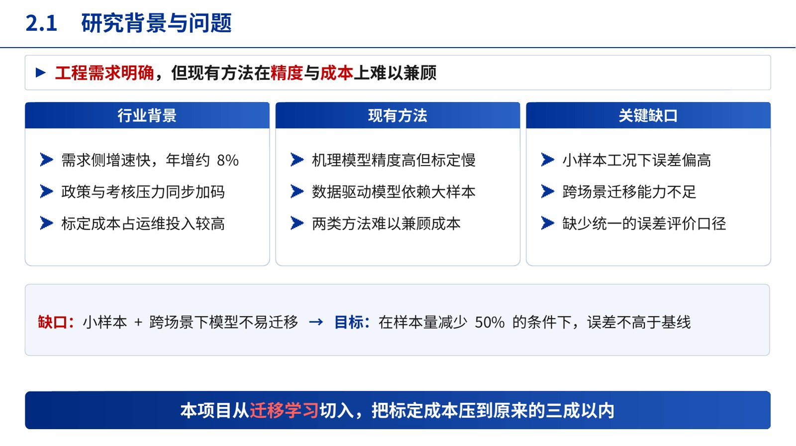 | 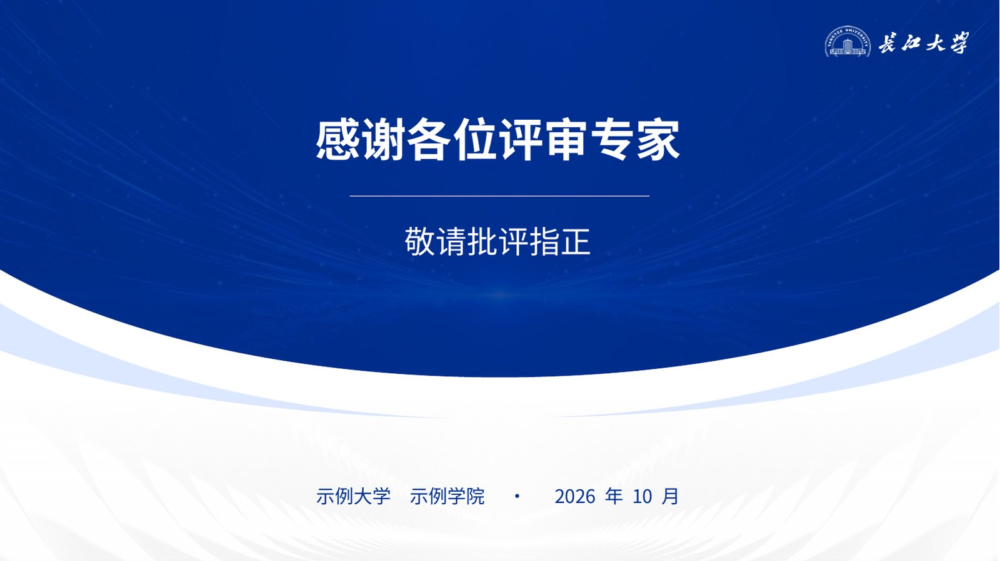 |

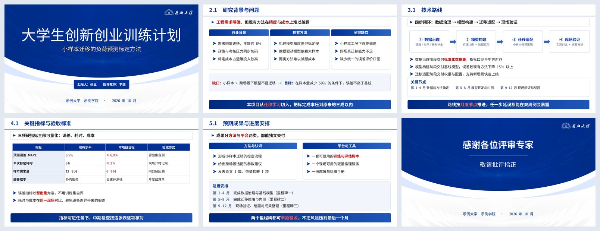

## 示意图留空

流程图、机理图这类示意图不由 AI 自己拼画，先留出空图位并附上生图提示词，再用网页端 ChatGPT 等工具生成后填入。

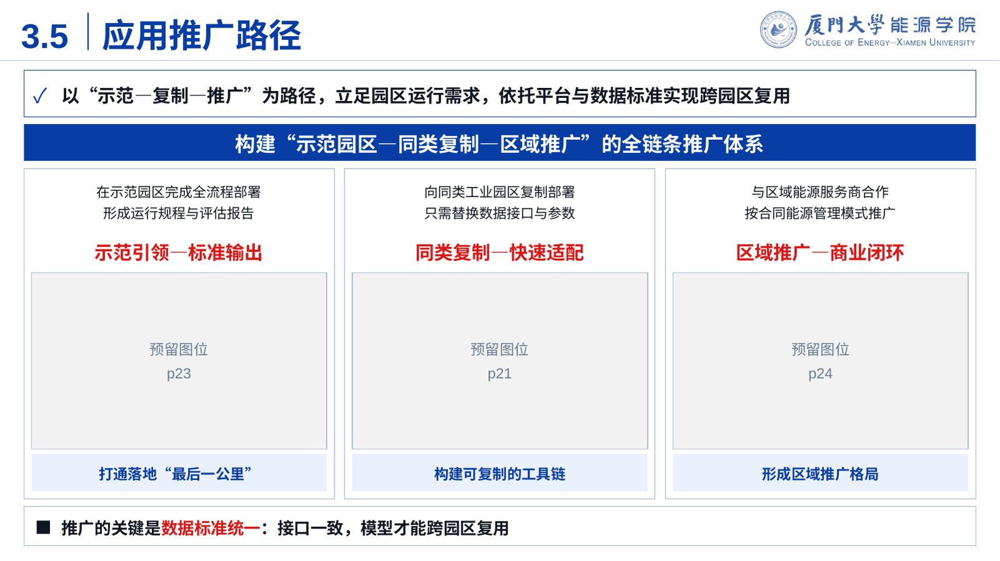

---

使用方法：把 [`research-ppt-skill`](research-ppt-skill/)（科研汇报）或 [`dachuang-ppt`](dachuang-ppt/)（大创申报答辩）文件夹放进 AI 助手的技能目录，安装与依赖见各自的 `INSTALL.md`。更新记录见 [CHANGELOG.md](CHANGELOG.md)，许可 MIT。
